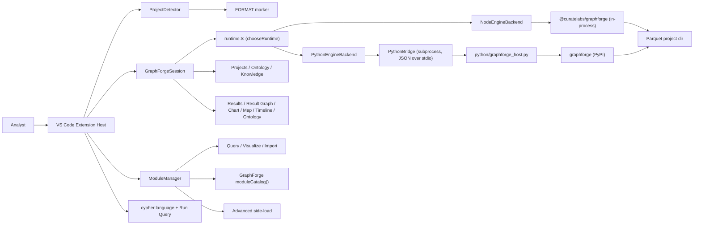

# Architecture

GraphForge for VS Code is a TypeScript extension host that wraps a runtime-agnostic
`EngineBackend` — either `@curatelabs/graphforge` (default) or a Python `graphforge` bridge
subprocess (#12) — decodes Arrow IPC results, and presents workbench UI: tree views, Cypher
language support, analyst-verb commands, and webviews for ontology and XYG visualizations.

Query, visualization, and import are first-party modules activated through the same module
lifecycle used by GraphForge-catalog and side-loaded modules. The future catalog is the happy
path for externally developed modules. See
[`MODULES.md`](MODULES.md) for the manifest and provider contracts and
[ADR-0002](./adrs/0002-unified-module-lifecycle.md) for the catalog-first
lifecycle decision.

How the extension fits with GraphForge Core, XYG, and the Hub (graphforge.sh) is decided in
GraphForge ADR 0054, published verbatim as [`PRODUCT_BOUNDARIES.md`](PRODUCT_BOUNDARIES.md).
[ADR-0005](./adrs/0005-hub-extension-core-xyg-interplay.md) records what that decision means
for this extension, along with its rollout. Where this document describes the current state
differently, those two documents state the target.

## Context diagram



## Components

| Component | Responsibility | Depends on |
|---|---|---|
| `extension.ts` | Activation, register commands/views | Session, views, commands |
| `ModuleManager` | Install/enable lifecycle for defaults, GraphForge catalog entries, and side-loads | global state, Session, native catalog |
| `ProjectDetector` | Exact `FORMAT` detection, CURRENT/ontology file reads | Node fs |
| `nativeLoader` | Resolve optional `@curatelabs/graphforge` | config / node_modules / sibling repo |
| `pythonLoader` / `pythonProbe` | Detect a Python interpreter and probe `import graphforge` | vscode config/extensions API, `execFile` |
| `nodeEngineBackend` / `pythonBridge` | `EngineBackend` implementations over Node / Python | `types.EngineBackend` |
| `runtime` / `runtimeSelection` | Choose Node vs. Python per `graphforge.runtime`; open the backend | nativeLoader, pythonLoader, both backends |
| `GraphForgeSession` | Open project, execute/verbs, IPC→rows, graph payload | `EngineBackend` + arrow |
| `projectArtifacts` / `visualizationRegistry` | Resolve project files and delegate `xyg.intent/v1` validation to XYG | Node fs + project root |
| Tree providers | Projects, Ontology, Knowledge sidebars | Session |
| Commands | Run Query, verbs, open panels, load ontology, Setup (Native/Python) | Session, webviews |
| `XygVisualizationPanel` / `xygRuntime` | Instance/frame lifecycle and explicit field binding | Bundled XYG native engine and shared painter |

### Build tooling (Vite, #24)

Vite bundles the extension host and test/benchmark entries as Node libraries.
`webview-ui/vite.config.mts` builds the browser UI separately. Before these builds,
`scripts/build-xyg.mjs` builds and bundles the pinned XYG native engine, Node
facade and browser painter. The package targets the build host OS/architecture.

### Runtime abstraction (#12)

`GraphForgeSession` never talks to `@curatelabs/graphforge` or Python directly — it only depends on
the `EngineBackend` interface (`src/session/types.ts`), which exposes `execute`, the five
analyst verbs, `labels`/`relationshipTypes`, `ontologyMode`, `loadOntology`, and `dispose`, all
`Promise`-returning so the same session code works whether the backend is synchronous
(Node, wrapped in `NodeEngineBackend`) or a subprocess round-trip (Python, `PythonEngineBackend`).

`runtime.ts` reads `graphforge.runtime` (`auto` | `node` | `python`, default `auto`), checks
Node-binding and Python-interpreter availability, and calls `chooseRuntime` (in the
`vscode`-free `runtimeSelection.ts`, so the selection logic is unit-testable without an
extension host) to decide which backend `openEngineBackend()` constructs. In `auto`, **Node is
the global default**, with one exception: a Python-first workspace (see "Project-kind detection"
below) prefers Python even when Node is available. An explicit `node` or `python` preference
never falls back to the other, and never consults project kind.

### Supported-Core declaration (#95)

`package.json` holds the single declaration, `graphforge.qualifiedCore` (`range`, `refuseBelow`), and
the `@curatelabs/graphforge` peer range tracks it. `coreQualification.ts` (`vscode`-free) reads it and
compares the resolved binding's version (`version()` for Node, the probe's `__version__` for Python;
PEP 440 prereleases such as `0.6.0rc5` are mapped to semver) with `semver`. `openEngineBackend()`
gates the chosen runtime: below `refuseBelow` throws `CoreVersionError` (`CORE_VERSION_UNSUPPORTED`,
presented as an error with its code); other out-of-range or unparsable versions show a one-time
warning (`CORE_VERSION_UNQUALIFIED`) and continue. `buildEnvironmentReport` exposes the declaration
and per-runtime verdicts under `core`, and a non-qualified active runtime leads `nextAction`; agent
context embeds the same report. The check is a single version comparison - Core's data/format and
Hub version errors and warnings (Core #1769/#1936) pass through, per ADR 0054 and consistent
with xyg#936. Clone outcomes retain Core's `warnings` from both successful receipts and error
documents. `GF_CORE_VERSION_MISMATCH` keeps Core's code/message and producing/running versions,
with guidance to choose `graphforge.engineVersion` and rerun Setup Native Binding for another
clone. A matching Python environment can open the cloned project afterward; cloning itself uses
the Node binding. Interactive clones display these warnings; agent calls receive them
in the structured outcome. The extension does not compare the data's versions itself or refuse a
clone because Core warned. Live qualification uses a candidate binding containing Core #1936
and an authentic fixture produced by a different Core version. Official build artifacts can
provide that candidate before registry publication. The `0.6.0-rc.6` candidate cloned the
unchanged `0.6.0-rc.5` native preview fixture successfully, preserving the warning and guidance
through the packaged extension. See the [bounded #88 qualification](./TESTING.md#uri-qualification-88).

### Project-kind detection (auto Python-prefer rule)

`projectKind.ts` (pure, `vscode`-free — same testing convention as `runtimeSelection.ts`)
classifies the workspace as `"python"`, `"node"`, or `"ambiguous"` from static signals gathered
by `projectKindDetector.ts`:

- **Python markers:** `pyproject.toml`, `requirements.txt`, `uv.lock`, `.python-version`,
  `Pipfile`, `environment.yml`/`.yaml`, `setup.py`, a notebook-dominant workspace root
  (`*.ipynb` files at least as common as `.ts`/`.tsx`/`.js`/`.jsx`/`.py` files), or the VS Code
  Python extension reporting an explicitly selected interpreter.
- **Node markers:** a `package.json` at the workspace root.
- **Both present:** Python wins only on a *strong* signal — `pyproject.toml`/`uv.lock` (a real
  uv/Python project manifest, not just a stray `requirements.txt`), or Python `graphforge`
  already being importable in a detected interpreter. Otherwise the workspace is `"ambiguous"`.
- **Neither present:** `"ambiguous"`.

`chooseRuntime(preference, node, python, projectKind)` only consults `projectKind` when
`preference === "auto"`: if `projectKind === "python"` and Python is usable, Python is chosen
even though Node is also available; otherwise the pre-existing Node-first `auto` behavior applies
unchanged. This means `"node"` and `"ambiguous"` project kinds are handled identically — Node
stays the default — matching the product rule "Node remains the global default only when the
repo is Node-ish or ambiguous." `graphforge.runtime` set explicitly to `node` or `python`
overrides this detection entirely.

### Python bridge protocol

`python/graphforge_host.py` ships with the extension (never executed from workspace-local
Python) and is spawned once per open project as a long-lived subprocess — matching the Node
binding's in-process `GraphForge` object lifetime and avoiding a fresh interpreter/import cost
per call. `PythonBridge` (`src/session/pythonBridge.ts`) owns the child process and speaks a
small, versioned, newline-delimited JSON protocol:

```text
→ stdin  (one JSON object per line): {"id": <int>, "op": <str>, ...op-specific fields}
← stdout (one JSON object per line): {"id": <int>, "protocol_version": 1, "ok": true, "result": {...}}
                                   or {"id": <int>, "protocol_version": 1, "ok": false,
                                       "error": <str>, "error_kind": <str>, "code": <str|null>}
```

Ops: `open`, `execute`, `verb` (`{"verb": "rank"|"cluster"|"paths"|"analyze"|"similar"|"find", "args": {...}}`),
`labels`, `relationship_types`, `ontology_mode`, `load_ontology`, `list_assertions`, `close`.
Every table-shaped result is returned as `{"arrow_ipc_base64": <str>, "generation_uuid": <optional UUID string>}` (an Arrow IPC stream,
base64-encoded) so the extension's existing `apache-arrow` decode path — shared with the Node
binding — consumes it unchanged; non-table results are returned as `{"json": ...}` or bespoke
fields (e.g. `{"labels": [...]}`). Every request is a **thin marshal** straight to a
`graphforge.GraphForge` method call — no Cypher/verb/epistemic semantics are reimplemented in
the host script or the extension (NFR-2). Requests are correlated by `id` so concurrent calls
don't need to be serialized by the extension; a 30s per-request timeout and subprocess
`exit`/`error` handlers reject any pending requests rather than hanging. Diagnostics (tracebacks)
go to stderr only — stdout carries protocol JSON exclusively.

Bump `BRIDGE_PROTOCOL_VERSION` (`pythonBridge.ts`) and the host's `PROTOCOL_VERSION` together for
any breaking wire change, and document it here.

**Known gap:** the underlying `graphforge` Python package does not yet implement `labels()` /
`relationship_types()` (raises `NotImplementedError`, surfaced as `code: "GF_NOT_IMPLEMENTED"`).
`GraphForgeSession.labels()`/`relationshipTypes()` already treat backend failures as non-fatal
(return `[]`), so this degrades gracefully on Python today; it need not block adoption.

## Data model

See [XYG integration](XYG.md) for native composition, typed painting, lifecycle and export.

Workbench artifact layout:

```text
queries/*.cypher
results/query-result.json + query-result.md + timestamped history
visualizations/*.gfviz.json
mutations/*.cypher
data/… (sample source data and attribution)
notebooks/… (project-owned Python/Jupyter analysis that publishes normal artifacts)
apps/… (portable Python apps such as the air-routes Streamlit dashboard)
```

Epistemic statuses: `hypothesis | supported | refuted | disputed | retracted | superseded | statusless`.

## Domain language and boundaries

| Domain concept | Meaning in this project | Boundary / owner |
|---|---|---|
| Project | Directory with exact FORMAT bytes | Detector; engine storage |
| Analyst verb | Non-Cypher algorithm path returning Arrow | Engine; session wraps only |
| Ontology mode | exploratory / advisory / strict | Engine; viewer displays |
| Epistemic status | Belief state on knowledge subjects | Engine ledgers; UI colors extension-owned |
| Result graph | Visualization of query/verb rows | Extension webview |
| Visualization artifact | Reproducible presentation of a durable result | Studio project file; never GraphForge Core computation |

## Key flows

Node and Python backends capture generation identity with each read and associate it with that exact returned Buffer. Session reads and mutations bind each decoded result to the backend captured before the call. They reject backend replacement before exposure; paging cannot establish ownership for an unregistered result. Checkpoint query handles retain their opening backend across delayed input. Python hosts without the Core identity capability omit the field rather than inventing an identity.

### Run Cypher

1. User invokes Run Query — command
2. Session ensures project open — GraphForgeSession
3. `forge.execute` → IPC buffer — `@curatelabs/graphforge`
4. Keep Arrow authoritative and expose lazy row access — apache-arrow
5. Stream complete JSON + Markdown and timestamped history under `results/`,
   with original Arrow and a digest-checked `.resultmeta` publication pointer;
   reveal the Results `WebviewView` in the bottom Panel.
6. Return a bounded `ResultPage`; the command page API and Results UI use at most
   500 rows/4 MiB per page. When enabled, XYG composes original Arrow in the
   shared visualization editor group. Inspect projects only the visible page.

### Link table and graph selections

1. Results posts a source row/cell with result ID, view revision and page version.
2. The host rejects stale contexts and asks XYG for exact native membership.
3. Graphs use canonical UUIDs; analytical compositions use selected source rows
   within the exact result/generation contract, distinct from filtering rows.
4. Native picks resolve back through owner provenance, including reordered,
   filtered and gathered marks. The host retains membership and reveals the
   appropriate bounded page. It never derives a source row from point order.


### Render and inspect a result graph

See [XYG integration](XYG.md) for native composition, typed painting, lifecycle and export.

### Open an XYG chart, map, or timeline

See [XYG integration](XYG.md) for native composition, typed painting, lifecycle and export.

### Clone from the Hub

1. The Hub's Open tab links to `vscode://curatelabsai.graphforge/clone?repository=owner/repo`,
   or a user or agent calls `graphforge.cloneFromHub`.
2. `hubClone.ts` (vscode-free) validates the identity, branch ref, and Version UUID locally, so
   a malformed link never reaches Core. A clicked link always confirms before any disk or
   network work.
3. The binding's in-process `runCli(["clone", repo, destination, "--json", ...])` does
   discovery, download, verification, and import (`graphforge-hub-clone/1`). The extension
   never speaks the Hub protocol ([ADR-0005](./adrs/0005-hub-extension-core-xyg-interplay.md)).
4. The receipt maps to `{ repository, destination, immutableVersion, packageDigest,
   generationUuid }`. Core's structured errors pass through with their `hub.*` semantic code.
5. `graphforge.openProject` opens the destination, so project detection stays in one place.

**Destination storage.** A cloned project is a durable, path-backed project, so Core admits or
rejects the destination volume (fail closed, no partial destination; the extension adds no
cleanup). Core's contract: Linux local ext4/XFS/Btrfs, macOS local APFS, Windows fixed writable
local NTFS, judged on the project folder's own volume. A supported volume may be mounted beneath
a container or VM root that is not itself supported, so the extension imposes no process-root
restriction and does not probe filesystems. On `GF_UNSUPPORTED_FILESYSTEM` the code and message
pass through unchanged and `nextAction` names the admitted volumes for the **extension host**
(`process.platform` plus `vscode.env.remoteName`), because in WSL, SSH, and container windows
Core and the destination run there, not on the machine showing the UI. A filesystem name is not a
promise that every mount passes. An in-memory `GraphForge()` session needs none of this: it is a
runtime capability, whereas clone/open need an admitted durable volume.

`runCli` is synchronous, so a long download blocks the extension host until Core finishes.
An asynchronous Core entry point would remove that limit.

### Publish to the Hub

1. A user runs `graphforge.publishToHub` from the palette, or an agent calls it with
   `{ repository, ref | versionUuid, confirm: true }`. A binding without `gf publish` (0.5.x)
   fails closed with `PUBLISH_UNSUPPORTED` before any prompt (`publish --help` probe).
2. `hubPublish.ts` (vscode-free) validates the identity and exactly one of Branch ref or Version
   UUID, and rejects any preview selection (`HUB_PUBLISH_PREVIEWS_UNAVAILABLE`). Agent calls
   without `confirm: true` return `CONFIRMATION_REQUIRED`; palette calls show a modal listing the
   repository, selection, project, and the binding's `version()` as the producing Core version.
3. The binding's in-process `runCli(["publish", repo, "--project", root, "--json", "--ref" |
   "--version-uuid", ...])` derives, verifies, and uploads the native package
   (`graphforge-hub-publish/1`). The extension passes no file paths, so notebooks, apps, intent
   documents, and saved results are never sent.
4. Core owns the credential. In-process calls never run Core's device flow, so with no
   `GRAPHFORGE_HUB_PUBLISH_TOKEN` in the extension host's environment Core returns
   `hub.publish.auth_denied` with its next action, which the extension passes through. The
   extension stores no token and logs no repository content or raw Core output.
5. The receipt maps to `{ repository, refs, revision, previousRevision, manifestValidator,
   operationUuid, requestCommitment }`. Core's `hub.publish.*` semantic codes pass through.

Previews are deferred: the pinned Core's `gf publish` has no preview flag, and XYG's PNG/SVG
static export (CurateLabs/xyg#935) does not exist yet. Recording the producing Core version in
the published Version waits on CurateLabs/graphforge#1769; until then it appears only in the
confirmation and the result (`coreVersion`).

### Open ontology

1. User opens Ontology view or Show Ontology — command/tree
2. Read `ontologyMode` + workspace `ontology.json` — session/detector
3. Ontology Viewer webview renders mode + types

## Cross-cutting concerns

- **Error handling:** Fail closed on missing binding or invalid FORMAT; `showErrorMessage`. When
  no runtime is usable, the message and recovery actions cover **both** Setup commands (#12).
- **Configuration:** `graphforge.nativeModulePath`, `graphforge.openResultGraphOnQuery`,
  `graphforge.runtime`,
  and `graphforge.pythonInterpreterPath`. Get Started derives its journey from
  runtime/session state plus project-owned artifacts; it has no separate onboarding
  mode or completion setting.
- **Package manager policy:** Python package installs use **`uv` only, never `pip`** —
  `GraphForge: Setup Python Binding`'s install choice runs `uv add graphforge` in a uv-managed
  project (`pyproject.toml`/`uv.lock` present) or `uv pip install --python <interpreter>
  graphforge` otherwise. If `uv` is not on `PATH`, the command tells the user to install uv first
  and does not fall back to `pip install` (`setupPython.ts`).
- **Security:** Webview CSP restrictive; scripts only for panel UI; no remote project trust
  beyond workspace folders. The Python bridge only ever spawns the extension-bundled
  `graphforge_host.py` (never a workspace-local script) with a user-selected interpreter.
  Side-loaded modules are declarative by default. A contained CommonJS entrypoint
  can execute only behind a machine-scoped dangerous user setting, Workspace
  Trust, and a per-install confirmation; disabling the setting deactivates it.
  Visualization specs are JSON-only: no callbacks, `eval`, remote data sources,
  implicit map tiles, or embedded credentials. Invalid specs fail closed.
- **Observability:** Status bar shows project name, ontology mode, and active runtime (Node /
  Python), or a "no runtime" warning with both setup paths in the tooltip.
- **Performance:** Python interpreter/`graphforge`-import probes are cached for 15s
  (`pythonLoader.ts`) and invalidated on `graphforge.pythonInterpreterPath`/`graphforge.runtime`
  config changes, workspace folder changes, and (best-effort) Python-extension interpreter
  changes — see `extension.ts`.
  XYG owns visualization performance evidence; local host tests establish bounded composition and paint behavior.

## Decisions

See [XYG integration](XYG.md) for native composition, typed painting, lifecycle and export.

## Risks & trade-offs

- Native addon must match host OS/arch — document local `napi build` / link path.
- Epistemic attachment on UUIDs is stubbed until belief-projection is wired end-to-end.
- Bundling `apache-arrow` increases extension size but simplifies runtime.
- Python bridge adds subprocess lifecycle risk (hangs, unexpected exits) — mitigated by a 30s
  per-request timeout and `exit`/`error` handlers that reject all pending requests.
- Python analysis is intentionally separate from the bridge: VS Code Jupyter and
  Streamlit use the user's Python environment and import GraphForge directly.
  The extension only opens the notebook or app source; the notebook writes
  portable CSV/HTML exports and the app serves a browser dashboard rather than
  creating extension-only artifacts. The bridge preserves command parity, while
  analyst-authored notebooks and apps are the primary Python product surface.
- The Python `graphforge` package's API can move independently of `@curatelabs/graphforge`'s; the host
  script and `EngineBackend` mapping may need updates when it does (defensive coding, not a
  compatibility guarantee).

# Visualization instance lifecycle

Graph, chart, temporal, geospatial, and figure webviews are owned by a shared
`VisualizationInstanceRegistry`. Saved visualizations derive a privacy-safe,
stable instance ID from the project root and project-relative visualization
path; unsaved visualizations receive a UUID. Opening one visualization never
replaces a different instance.

Each controller owns a monotonically increasing render generation. Host
messages establish `{ instanceId, renderGeneration }`; every subsequent
webview event echoes that context. Controllers reject replies from another
instance or an older generation. Starting a render aborts superseded work, and
disposing a panel cancels its active work and releases registered resources.

Cross-view selection, time, and spatial updates are opt-in. The registry routes
coordination events only when source and target declare the same coordination
group, rejects stale source generations, and never echoes an event to its
source. Registry identities and lifecycle diagnostics contain no project path,
result row, property, coordinate, timestamp, vector, or artifact content.
